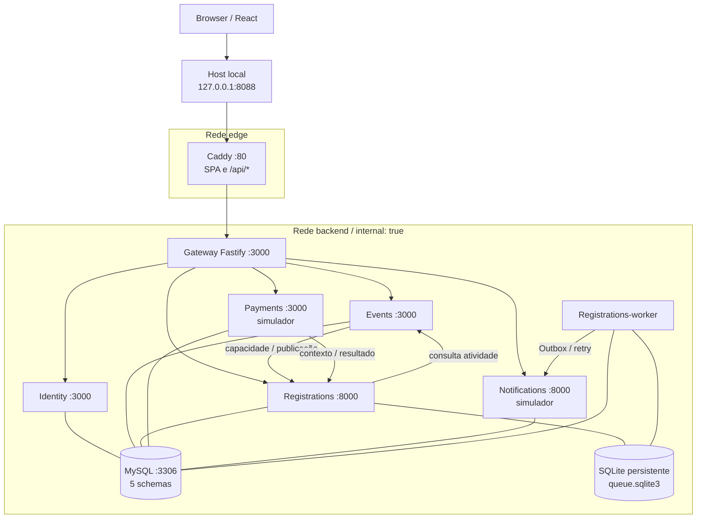
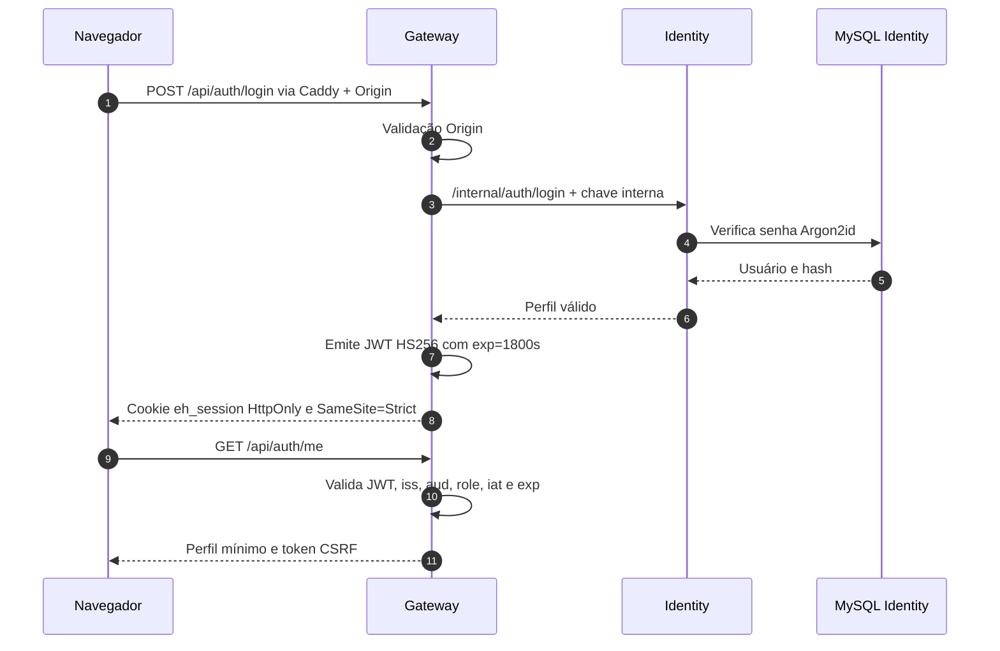
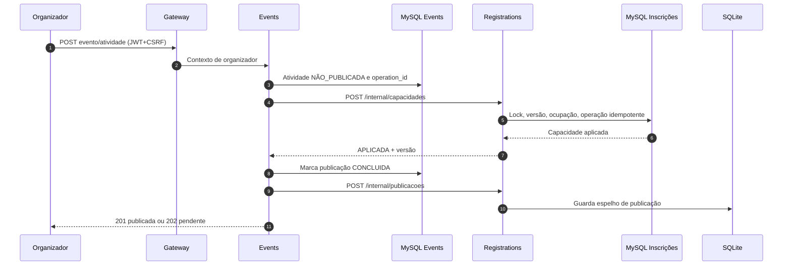
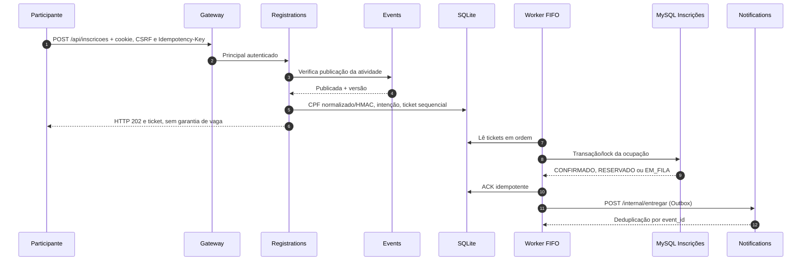

# EventHub — Arquitetura de Comunicação, Fluxos e Segurança de Rede

**Versão:** 1.0 — 04/11/2026
**Estado:** auditoria documental do código atual; **não equivale a homologação de produção**
**Fonte canônica:** repositório privado `Boanerges20297/eventhub`, branch `main`; trabalho no STI01 via NEXO
**Fase:** preparar frontend, contratos e documentação; **notebook e containers locais ficam para a última etapa**

> Este documento não autoriza abrir portas públicas, criar infraestrutura, implantar em VPS, iniciar containers no notebook nem alterar credenciais. O EventHub é um produto em evolução, não apenas uma demonstração descartável. O texto distingue implementação, decisões e provas de testes.

## 1. Situação arquitetural

O EventHub tem **cinco microsserviços de negócio**: Identidade, Eventos, Inscrições, Pagamentos simulados e Notificações simuladas. São complementados por Gateway Fastify, worker separado de Inscrições, Caddy e MySQL 8.4: **nove containers** com o Compose completo. React/Vite gera arquivos estáticos servidos por Caddy.

**Borda:** apenas o Caddy possui mapeamento `ports` no `compose.yaml`, associado a `127.0.0.1` e porta padrão **8088**, usando **HTTP local**. Os backends, o MySQL e o worker não possuem portas publicadas no host. A rede Docker `backend` está marcada como `internal: true`. O Caddy participa das redes `edge` e `backend` para ligar navegador ao Gateway.

**Dados:** MySQL físico único com **cinco schemas e contas distintas**. Cada microsserviço acessa seu próprio schema. O domínio Inscrições é **autoridade exclusiva sobre ocupação**, ao passo que Eventos define capacidade; nenhuma consulta direta a tabelas de outro serviço é autorizada. O SQLite `queue.sqlite3`, em volume persistente acessível a Inscrições e seu worker, gera tickets sequenciais e admite pedidos degradados, **sem conceder vagas**.

**Chaves de leitura:**
- **IMPLEMENTADO** = observado nos arquivos versionados em 04/11, não implica reteste Docker recente.
- **TESTADO** = evidência de cenário, data e limite descritos em checkpoint.
- **DECIDIDO** = decisão arquitetural aprovada, potencialmente ainda sem código.
- **PENDENTE** = não implementado ou não validado o bastante.

Os documentos de planejamento datados de 02/11 são **históricos**; afirmações antigas de "implementação não autorizada" ou "rotas ainda não implementadas" não devem sobrescrever checkpoints posteriores.

## 2. Componentes, responsabilidades e persistência

| Componente | Stack | Responsabilidade | Armazenamento |
| --- | --- | --- | --- |
| Frontend | React + Vite | UI e chamadas relativas à origem `/api` | Não acessa banco |
| Caddy | Servidor estático + proxy | Única borda TCP publicada; SPA e proxy `/api` | Nenhum |
| Gateway | Node.js + Fastify | Tabela fixa de rotas, JWT, RBAC, CSRF e Origin | Nenhum banco de domínio |
| Identity | Node/Fastify | Login, hash de senhas, cadastro, papéis, organizações | MySQL `eventhub_identity` |
| Events | Node/Fastify | Eventos, atividades, política, preço, capacidade definida e publicação | MySQL `eventhub_events` |
| Registrations | Python/FastAPI | Tickets, validação de publicação, reserva, fila e titularidade | MySQL `eventhub_inscricoes` + SQLite |
| Registrations-worker | Python | Conciliação FIFO, promoção, expiração, Outbox e retry | Mesmo MySQL/SQLite do serviço Inscrições |
| Payments | Node/Fastify | Tentativas e respostas **simuladas**, sem cobrança real | MySQL `eventhub_payments` |
| Notifications | Python/FastAPI | Inbox/entregas idempotentes **simuladas**, sem SMTP | MySQL `eventhub_notifications` |
| MySQL | MySQL 8.4 + InnoDB | Servidor físico comum com permissões SQL por schema | Volume `mysql_data` |
| SQLite | Arquivo, não container | Tickets duráveis e espelho de publicação conhecida | Volume `sqlite_data` em `/app/data/queue.sqlite3` |

**Somente modelados:** Check-in, Certificados e Relatórios. **Não** lhes atribuir portas, containers ou rotas operacionais nesta fase.

## 3. Topologia efetiva e zonas de confiança



**Atenção:** `internal: true` não é firewall por microsserviço. Os containers do backend compartilham a mesma rede lógica, e um serviço comprometido pode tentar se conectar aos outros. A autenticação interna é, portanto, indispensável. O Caddy está também na rede `backend` por necessidade de proxy.

### 3.1 Matriz de portas e exposição

| Componente | Porta no container | Publicada no host? | Redes |
| --- | --- | --- | --- |
| Caddy | 80/TCP | **Sim:** `127.0.0.1:8088` por padrão | `edge`, `backend` |
| Gateway | 3000/TCP | Não | `backend` |
| Identity, Events, Payments | 3000/TCP por serviço | Não | `backend` |
| Registrations, Notifications | 8000/TCP por serviço | Não | `backend` |
| MySQL | 3306/TCP | Não | `backend` |
| Worker / SQLite | Sem listener de serviço dedicado | Não | `backend` / volume |

O mapeamento do Caddy é parametrizado por `EVENTHUB_HTTP_PORT`. O host em loopback não oferece acesso a outros computadores. Expor na Internet requer **outra decisão de implantação** e hardening prévio.

### 3.2 Matriz de comunicação entre serviços

| Origem → destino | Implementação de referência | Motivo / controle |
| --- | --- | --- |
| Browser → Caddy → Gateway | `/api/*` → `gateway:3000/*` | Origem única; Gateway valida sessão e autorização |
| Gateway → Identity | `POST /internal/auth/login`, `/register` | Autenticação via chave interna |
| Gateway → Events | `/internal/eventos`, `/internal/eventos/{id}/atividades`, `/internal/atividades/*` | Consultas públicas; mutações por organizador e ownership |
| Gateway → Registrations | `/internal/inscricoes`, `/internal/inscricoes/{id}`, `/cancelar` | Principal/titular, CPF, idempotência |
| Gateway → Payments | `/internal/pagamentos/{id}`, `/simular` | Principal/titular; **não é cobrança real** |
| Gateway → Notifications | `GET /internal/notificacoes` | Inbox do `sub` autenticado |
| Events → Registrations | `POST /internal/capacidades` e `/internal/publicacoes` | Versiona capacidade aplicada e espelha publicação validada |
| Registrations → Events | `GET /internal/atividades/{id}` | Verifica publicação antes de aceitar pedido |
| Payments → Registrations | `GET /internal/inscricoes/{id}/pagamento`, `POST .../inicio-pagamento` e `.../resultado-pagamento` | Valida titular e aplica resultado financeiro idempotente |
| Registrations-worker → Notifications | `POST /internal/entregar` | Outbox, reenvio e deduplicação por `event_id` |
| Cada serviço → MySQL | `mysql:3306`, TCP | Usuário/schema de menor privilégio por domínio |
| Registrations + worker → SQLite | `/app/data/queue.sqlite3` | Mesmo volume persistente do emissor FIFO |

Chamadas internas utilizam **HTTP** dentro da rede Docker. Não existem mTLS nem certificados individuais por serviço nesta implementação.

O Caddy atual (`infra/caddy/Caddyfile`) escuta `:80`, comprime gzip/zstd, encaminha `/api/*` para `gateway:3000` e serve a SPA React. **Não há HTTPS público configurado.**

## 4. Autenticação, autorização e confiança entre serviços

### 4.1 Login e sessão



**Controles implementados:**
- Identity: senha com **Argon2id**; cadastro público apenas como `participant`.
- JWT no gateway: HS256, `sub`, `role`, `org_id`, `iss`, `aud`, `iat`, `exp`; validade **30 minutos**; sem refresh token.
- Cookie: `eh_session`, `Path=/api`, `Max-Age=1800`, `HttpOnly`, `SameSite=Strict`; `Secure` condicionado a `EVENTHUB_COOKIE_SECURE`.
- **Configuração local:** `compose.yaml` define `EVENTHUB_COOKIE_SECURE: "false"` devido ao HTTP loopback. **Alterar para true, testar HTTPS e cabeçalhos antes de qualquer publicação pública.**
- Gateway: bloqueia Origin incorreta em mutações, verifica CSRF com cookie, papel por rota, tabelas de destinos fixos; desconhecido → 404.
- Defense-in-depth: Events valida organização proprietária; Registrations consulta apenas tickets do titular; Payments e Notifications verificam usuário quando aplicável.
- `GET /api/eventos` é público; dados pessoais e ações exigem autenticação.

### 4.2 Identidade interna implementada e seu risco

Gateway e demais backends usam:
- `X-EventHub-Internal-Key`: segredo compartilhado `EVENTHUB_INTERNAL_SECRET` de comprimento mínimo verificado.
- `X-EventHub-Auth`: principal do usuário serializado em **Base64URL**, **sem assinatura independente**.

O cabeçalho de principal só é confiável **enquanto a chave compartilhada permanecer secreta**. Um container comprometido que extraia a chave poderia falsificar identidade perante os outros. Logo, **não chamar essa implementação de Zero Trust**, autenticação mútua TLS ou identidade forte por serviço.

**Pendente para produção:** chaves distintas por emissor/destinatário ou autenticação forte por serviço, contexto com emissor/destino/expiração assinado, rotação de segredos e redução de alcance lateral. A escolha definitiva deve decorrer da análise de ameaças, não ser incorporada silenciosamente.

### 4.3 Matriz de autorizações

| Papel / origem | Permissões atuais | Limite imposto pelo domínio |
| --- | --- | --- |
| Anônimo | Cadastro/login, leitura de eventos/atividades publicados | Sem consulta de inscrições/notificações |
| `participant` | Solicitar/cancelar e consultar suas inscrições; simular seu próprio pagamento | Ownership pelo `sub` |
| `organizer` | Criar eventos/atividades e sincronizar os seus | `org_id` validado em Events |
| `admin` | Operações explicitamente permitidas pelas rotas | Não implica leitura ilimitada de CPF/tickets alheios |
| Serviço interno | Só operações permitidas por endpoint | Hoje usa segredo compartilhado, não identidade individual de serviço |

**Atenção a claims:** RBAC no gateway não substitui checagem de dono da organização/recurso no microsserviço. Frontend não é limite de segurança.

## 5. Fluxos e invariantes de consistência

### 5.1 Publicação de uma atividade



**Regras:** Eventos define capacidade; Inscrições controla ocupação sob transação InnoDB. Uma redução não pode passar abaixo de reservas ativas, em verificação e confirmadas. Versões e `operation_id` evitam aplicar mudança duas vezes. Não anunciar publicação enquanto sincronização de capacidade estiver pendente.

### 5.2 Inscrição FIFO, resposta 202 e Outbox



**Invariantes:** prioridade = ticket sequencial **do servidor**, não timestamp do navegador. `REGISTRADO`/`EM_FILA` não ocupam vaga. Reserva e confirmação só acontecem em MySQL/InnoDB. Mutações de inscrição possuem `Idempotency-Key`; reenvio da mesma intenção não cria outro ticket. CPF+atividade impede inscrição ativa duplicada, sem publicar CPF em JWT/listagem.

**Entrega de eventos:** `at-least-once` + deduplicação; **não** promessa de exactly-once distribuído. Falha em Notificações não reverte inscrição.

### 5.3 Pagamento **somente simulado**

- Gateway encaminha `POST /api/pagamentos/{id}/simular` para Payments; Payments consulta inscrição do titular, persiste tentativa e comunica início/resultado a Registrations.
- `PAGO` tempestivo confirma sem somar outra vaga; `RECUSADO_DEFINITIVO` libera a primeira reserva e promove FIFO; `INDETERMINADO` preserva a vaga em `EM_VERIFICACAO`.
- Prazo padrão de reserva **30 minutos**, configurável por atividade a partir da concessão. Um pagamento ocorrido dentro do prazo pode confirmar com retorno tardio após validação confiável.
- Janela de verificação de **15 minutos** e PIX administrativo de **30 minutos** são decisões aprovadas, mas **não estão demonstrados como processo financeiro real seguro**.
- Não existe provedor bancário, cobrança real nem SMTP.

### 5.4 MySQL indisponível — modo degradado

1. Registrations tenta validar que a atividade foi publicada em Events.
2. Quando Events/MySQL estão indisponíveis, só aceita ticket se houver **espelho durável de publicação previamente verificada** e ainda válido no SQLite. Atividade desconhecida → erro, **falha fechada**.
3. Emite ticket no SQLite e responde `202`. **Não reserva** nem confirma vaga enquanto MySQL está fora.
4. Depois do retorno do MySQL, worker reconcilia em ordem FIFO, com transações e sem ultrapassar a capacidade.
5. Outbox reenvia notificações sem duplicar efeitos.

**Risco documentado:** lease de publicação até **24 horas** não garante detectar revogação recente durante uma partição; resposta 404/410 válida de Events remove espelho. MySQL/VPS únicos continuam pontos de falha. Crash exato entre commit InnoDB e ACK SQLite ainda não tem ensaio integral de processo/container.

## 6. Segurança de rede e riscos para evolução do produto

| ID | Condição observada | Consequência | Situação |
| --- | --- | --- | --- |
| SEC-01 | Caddy HTTP `:80` e cookie `Secure=false` na configuração local | Inadequado à Internet | **Bloqueador de exposição pública**: HTTPS, Secure=true, headers de borda e teste |
| SEC-02 | `EVENTHUB_INTERNAL_SECRET` compartilhado | Um backend comprometido pode falsificar contexto de outro | **Bloqueador de exposição pública**: identidade/assinatura de serviço e rotação |
| SEC-03 | Uma rede interna para todos os backends | Alcance lateral entre containers | Rever segmentação/identidade; não pressupor ACL por serviço |
| SEC-04 | Sem rate limit identificado em Caddy/Gateway | Bruteforce/DoS/abuso de fila | **Bloqueador de exposição pública**: limitação por rota e testes |
| SEC-05 | MySQL e volumes em um único host | SPOF e potencial perda de dados | **Bloqueador de exposição pública**: backup, restore ensaiado e monitoramento |
| SEC-06 | `restart: unless-stopped` + healthcheck | `unhealthy` não implica reinício automático | Watchdog de no máximo três tentativas + alerta é **DECIDIDO, não IMPLEMENTADO** |
| SEC-07 | Logs sem correlação ponta a ponta uniforme | Diagnóstico, auditoria e forense limitados | `X-Request-ID`, correlation IDs e mascaramento de dados |
| SEC-08 | Publicação cacheada em partição | Revogação pode não ser percebida antes do lease | Política de revogação/validade a revisar e testar |
| SEC-09 | Pagamentos e notificações em simulação | Não equivalem a transações ou entregas reais | Contratos/provedores exigem projeto e testes específicos |
| SEC-10 | Contratos antigos ainda marcados "propostos" | Risco de integrar endpoints não existentes | Comparar rotas implementadas com contratos, gerar especificação atual |

**Segredos:** `.env` privado ignorado no Git; `scripts/init-env.ps1` prepara variáveis. Não registrar credenciais, tokens, CPF original nem dados reais nos documentos/commits/logs. A inicialização do MySQL cria schemas e contas com privilégios restritos ao próprio schema, sem dar ao usuário de cada serviço acesso aos demais.

**Privacidade:** CPF HMAC e validação são mecanismos de minimização local, **não** substituem políticas de retenção, backup, acesso e descarte exigidas por LGPD e por uso real.

**Limites do Docker:** `backend.internal` diminui superfície; `healthcheck` não é monitor/alerta completo; o host continua ponto único de falha. Não declarar "resistente a qualquer falha".

## 7. Evidências verificadas e limites

| Data / ambiente | Resultado de teste | O que realmente prova |
| --- | --- | --- |
| 02/11, notebook Docker | `HTTP_E2E_OK` | Autenticação, CSRF, RBAC, ownership, FIFO e promoção no cenário sintético |
| 03/11, notebook Docker | `PAYMENTS_E2E_OK` / `NOTIFICATIONS_E2E_OK` | Simuladores financeiros e de notificação integrados |
| 03/11, ambiente isolado `eventhub-chaos` | Notifications desligado, Outbox com 3 tentativas e dedupe após retomada | Retry/deduplicação no cenário ensaiado |
| 03/11, `eventhub-chaos` | API degradada: 3 tickets conhecidos, atividade desconhecida rejeitada; 2 confirmados/1 em fila após recuperação | Admissão via publicação conhecida e reconciliação FIFO |
| 03/11, `eventhub-chaos` | **200 requisições HTTP / 30 vagas** com MySQL parado: 200 respostas 202; 30 confirmados e 170 em fila após recuperação | Lote sintético específico; sem overbooking; **não é benchmark de carga sustentada** |
| 04/11, STI / Edge | Build React, drawer testado, responsividade em 320/390/700/701/1440px; 69 testes Python (10 skipped) e 2 testes Node | UI, segurança local e regras; **não** reexecução Docker E2E dos endpoints recém-alterados |

**Falha preservada como evidência:** antes do ajuste de timeout do Gateway, 200 chamadas sob MySQL indisponível resultaram em HTTP 503 apesar de tickets persistidos. Corrigido o timeout **somente de POST /inscricoes** para 45 segundos e mantida a mesma `Idempotency-Key` para retry de resposta ambígua; novo ensaio alcançou 200 respostas 202. Não esconder o primeiro teste.

**Referências:** `docs/CHECKPOINT_2026-11-02.md`, `docs/CHECKPOINT_2026-11-03.md`, `docs/CHECKPOINT_2026-11-04.md` e roteiros E2E versionados em `scripts/`.

## 8. Checklist da integração final — **NÃO EXECUTAR AGORA**

**Pré-condições:** UI e contratos aprovados, código final versionado, revisão de segredos, `main` sincronizada e análise das divergências entre máquinas. Preservar dados/volumes; **não** usar `docker compose down -v`, `git reset --hard` ou `git push --force` para conciliar.

**Somente quando a fase final no notebook for expressamente autorizada:**

```powershell
git status --short --branch
git pull --ff-only origin main
.\scripts\init-env.ps1
docker compose config --quiet
docker compose build
docker compose up -d
docker compose ps
Invoke-RestMethod http://127.0.0.1:8088/api/health
python -m unittest discover -s services/registrations/tests -q
node --test services/node/security.test.js
Get-Content -Raw .\scripts\test_http_e2e.js | docker compose exec -T identity node -
Get-Content -Raw .\scripts\test_payments_e2e.js | docker compose exec -T identity node -
Get-Content -Raw .\scripts\test_notifications_e2e.js | docker compose exec -T identity node -
```

**Critérios de aceite a observar:** apenas Caddy publicado em loopback; bancos inacessíveis pelo host; login/Origin/CSRF/401/403; usuários e organizações isolados; catálogo e publicação sincronizados; ticket 202/consulta/cancelamento; idempotência sob retry; deduplicação Outbox; HTTP E2E após a nova UI; contingência em ambiente isolado sem apagar volumes. Registrar hash, cenário, resultado, exceções e evidências. Não executar testes destrutivos no ambiente principal.

## 9. Próximas decisões e rastreabilidade

1. **Agora no STI:** fechar páginas/contratos reais, documentação de check-in/certificados/relatórios modelados e UX; não ligar notebook.
2. **Antes de internet/produção:** tratar SEC-01/02/04/05, hardening e política de credenciais; revisar plano de ameaças.
3. **Última etapa autorizada:** ligar containers do notebook, reexecutar E2E e provas de falha, conciliar documentação acadêmica.
4. **Futuro produto:** avaliar domínio/VPS, HTTPS público, provedor financeiro real e entrega de e-mail mediante novas decisões.

| Tema | Fontes de código / documentação |
| --- | --- |
| Topologia / borda | [Compose](../compose.yaml), [Caddyfile](../infra/caddy/Caddyfile) |
| Gateway / sessão | [Gateway](../services/node/gateway.js), [Security](../services/node/security.js), [Identity](../services/node/identity.js) |
| Publicação e ocupação | [Events](../services/node/events.js), [Registrations](../services/registrations/app/main.py) |
| Pagamento e notificações | [Payments](../services/node/payments.js), [Notifications](../services/notifications/app/main.py) |
| UI / conexão | [API frontend](../frontend/src/api.js), [Frontend handoff](FRONTEND_HANDOFF_2026-11-04.md) |
| Decisões e ADR | [Decisões](planejamento/decisoes-arquiteturais.md), [ADRs](planejamento/adrs-formais.md) |
| Fluxos e contratos históricos | [Fluxos](planejamento/fluxos-e-estados.md), [Contratos](planejamento/contratos-api.md) |
| Operação e teste | [Execução local](EXECUCAO_LOCAL.md), [Checkpoint 03/11](CHECKPOINT_2026-11-03.md), [Checkpoint 04/11](CHECKPOINT_2026-11-04.md) |

**Conclusão:** a arquitetura local tem superfície publicada mínima, controles de sessão e consistência demonstrados em cenários específicos. **Não está homologada para produção.** Toda mudança de porta, protocolo, fronteira, identidade de serviço, política de acesso ou infraestrutura requer atualização desta matriz e nova validação.
